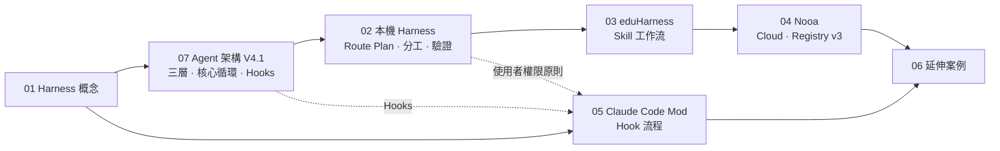

# llm_teach｜LLM 教學文章索引

把 bai-collab 各 repo 中與 **LLM / Agent Harness / Claude Code mod** 相關的內容整理成可直接上課的講義。
**先看下面的「快速查找」，找到要講的主題就點進去。**

## 🔎 快速查找：我要講…

| 我要講… | 看這篇 | 關鍵字 |
|---|---|---|
| Harness 是什麼？跟模型差在哪？ | [01 什麼是 Harness](lessons/01-what-is-a-harness.md) | context、tools、guardrails、state、verification |
| Agent 完整架構：Harness／Agent／核心循環三層 | [07 AI Agent 架構 V4.1](lessons/07-ai-agent-architecture-v4-1.md) §1–§4 | Orchestration、Planner、Think→Act→Observe |
| Skill、Tool、MCP 差在哪 | [07](lessons/07-ai-agent-architecture-v4-1.md) §5 | Skill 編排 Tool、MCP 是連接方式 |
| **Hooks 生命週期介入點（Pre-Agent / Pre-Tool / Post-Tool…）** | [07](lessons/07-ai-agent-architecture-v4-1.md) §6 | 對照 Claude Code hooks |
| Reflection 與回饋迴圈、Final Answer vs Artifact | [07](lessons/07-ai-agent-architecture-v4-1.md) §7 | Feedback Loop |
| AI 任務怎麼一步步跑（分類→規劃→核准→執行→驗證） | [02 本機 Harness](lessons/02-local-harness-adaptive-loop.md) §2 | adaptive loop、11 blocks |
| Route Plan 是什麼、每個節點要寫什麼 | [02](lessons/02-local-harness-adaptive-loop.md) §3 | objective、depends_on、fallback、verifier |
| Claude / Codex / agy 怎麼分工、怎麼派工 | [02](lessons/02-local-harness-adaptive-loop.md) §5 | 腦／手／眼、codex-rescue、advisory |
| 驗證要做多少？「誰做的不由自己審」 | [02](lessons/02-local-harness-adaptive-loop.md) §6 | Simple / Standard / Complex、verifier budget |
| 使用者權限為什麼最高 | [02](lessons/02-local-harness-adaptive-loop.md) §1、§5 | user-authority、Human Gate |
| Skill 是什麼、和 prompt 差在哪 | [03 eduHarness Skills](lessons/03-eduharness-skills-workflow.md) §1 | Registry、按需載入、package hash |
| 教育用 Skill 清單（教案、命題、遊戲…） | [03](lessons/03-eduharness-skills-workflow.md) §2 | 17 Skills |
| 一個需求怎麼變成 Skill 工作流程 | [03](lessons/03-eduharness-skills-workflow.md) §3–§5 | Skill resolution、dependency 條件、PDF→教案→題庫 |
| eduHarness 雲端版（ChatGPT / Gemini） | [04 eduHarness_Nooa](lessons/04-eduharness-nooa-cloud-registry-v3.md) | Descriptor、ENV、Notion、Dropbox |
| Official / Local 雙層 Registry | [04](lessons/04-eduharness-nooa-cloud-registry-v3.md) §4 | Registry v3、snapshot、Effective Routing View |
| 四代架構比較表 | [04](lessons/04-eduharness-nooa-cloud-registry-v3.md) §6 | 基本 → 本機 → eduHarness → Nooa |
| **Claude Code mod / plugin 怎麼寫** | [05 Claude Code Mod Hook 流程](lessons/05-claude-code-mod-hook-flow.md) | plugin.json、hooks.json、register.ts |
| **hook 事件流程（session.start / command.run / prompt.submit）** | [05](lessons/05-claude-code-mod-hook-flow.md) §3–§4 | middleware、`next(e)`、context 注入 |
| plugin 狀態保存與測試 | [05](lessons/05-claude-code-mod-hook-flow.md) §5–§6 | atom、claude-code/testing |
| 瀏覽器端小模型、離線去個資化、教師工作台 | [06 其他 LLM 專案](lessons/06-related-llm-projects.md) | WebLLM、Transformers.js、teacher_UI |
| **跟老師介紹 AI 怎麼用（教師研習開場動畫）** | [老師當導演（網頁動畫）](https://bai-collab.github.io/llm_teach/animations/teacher-as-director/)｜[原始檔](animations/teacher-as-director/index.html) | AI 五種角色、四處找資料、路網圖整理、換人檢查、錯誤筆記本 |
| **教師儀表板怎麼用（作答紀錄＋AI 分析）** | [教師儀表板導覽（網頁動畫）](https://bai-collab.github.io/llm_teach/animations/teacher-dashboard/)｜[原始檔](animations/teacher-dashboard/index.html) | 找學生、作答時間軸、最後有效成績、按送出才呼叫 AI、引用回查 |
| **老師用 Claude Code 做闖關教材（2D＋3D）** | [闖關教材製作（網頁動畫）](https://bai-collab.github.io/llm_teach/animations/quest-material/)｜[原始檔](animations/quest-material/index.html) | 下指令、先出規格再核准、2D 關卡作答、three.js 地形與淹水情境、三道驗收 |

## 📚 建議講課順序



- **只有 1 堂課**：01 → 07（§1、§6）→ 02（§2、§5）
- **講 Agent 基本架構**：07 全篇（可直接投影 `references/ai_agent_architecture/` 的互動 HTML）
- **想講 Hook 實作**：07 §6 → 05 全篇（附決策流程圖、測試、練習題）
- **教師研習**：先放 [老師當導演](https://bai-collab.github.io/llm_teach/animations/teacher-as-director/) 動畫（約 2 分鐘，可逐段停下解說）→ 01 → 03 → 04 §3（Human Gate）→ 06 teacher_UI

## 🗂️ 目錄

```text
llm_teach/
├─ README.md                         # ← 你在這裡：主題索引
├─ animations/                       # 教學動畫（單檔 HTML，GitHub Pages 可直接播放）
│  ├─ teacher-as-director/index.html # 老師當導演：跟 AI 一起備課（123 秒・10 段，成果牆可點開作品）
│  ├─ teacher-dashboard/index.html   # 教師儀表板導覽（60 秒・6 段，假資料）
│  └─ quest-material/index.html      # 闖關教材製作（92 秒・8 段，2D＋three.js 3D）
├─ lessons/                          # 講義（Markdown，GitHub 上可直接看 Mermaid 圖）
│  ├─ 01-what-is-a-harness.md
│  ├─ 02-local-harness-adaptive-loop.md
│  ├─ 03-eduharness-skills-workflow.md
│  ├─ 04-eduharness-nooa-cloud-registry-v3.md
│  ├─ 05-claude-code-mod-hook-flow.md
│  ├─ 06-related-llm-projects.md
│  └─ 07-ai-agent-architecture-v4-1.md
└─ references/                       # 原始資料快照（離線可用）
   ├─ ai_agent_architecture/         # AI Agent 完整架構 V4.1 互動 HTML
   ├─ eduHarness_Nooa/               # harness-map.html、architecture.html、流程圖 png
   └─ claude_code_mod/               # prompt-optimizer plugin 原始碼＋marketplace.json
```

## 🔗 原始來源

| 來源 | 線上 | 本地快照 |
|---|---|---|
| 治理 Harness 全景圖 | [harness-map.html](https://bai-collab.github.io/eduHarness_Nooa/docs/harness-map.html) | [references/eduHarness_Nooa/harness-map.html](references/eduHarness_Nooa/harness-map.html) |
| Harness → eduHarness → Nooa 架構視覺化 | [harness-eduharness-nooa-architecture.html](https://bai-collab.github.io/eduHarness_Nooa/docs/harness-eduharness-nooa-architecture.html) | [references/eduHarness_Nooa/harness-eduharness-nooa-architecture.html](references/eduHarness_Nooa/harness-eduharness-nooa-architecture.html) |
| eduHarness_Nooa 流程圖 | [repo docs/](https://github.com/bai-collab/eduHarness_Nooa/tree/main/docs) | [references/eduHarness_Nooa/eduHarness_Nooa-flow.png](references/eduHarness_Nooa/eduHarness_Nooa-flow.png) |
| AI Agent 完整架構 V4.1 | （使用者提供） | [references/ai_agent_architecture/ai_agent_architecture_v4_1.html](references/ai_agent_architecture/ai_agent_architecture_v4_1.html) |
| claude_code_mod | [bai-collab/claude_code_mod](https://github.com/bai-collab/claude_code_mod) | [references/claude_code_mod/](references/claude_code_mod/) |

快照版本：eduHarness_Nooa `dfd42ae`、claude_code_mod `e1ee8a0`（2026-10-11 擷取）。原 repo 更新後，以線上版本為準。

## ⚠️ 講課時注意

- 各來源的 Skill 數量不一致（17 / 27 / 40），隨版本成長；以 `skill-registry.json` 為準。
- Nooa README 仍寫 v0.2 / Registry v2，但 active Distribution 已是 v0.3 / Registry v3。
- Claude Code function hooks 是 early access API，介面可能變動。
- 原文中的模型版本名稱（如 Opus 4.8、gpt-5.6-luna）照原文引用，可能已更新。
