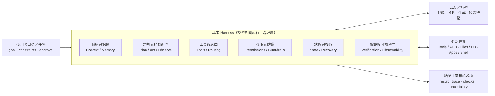
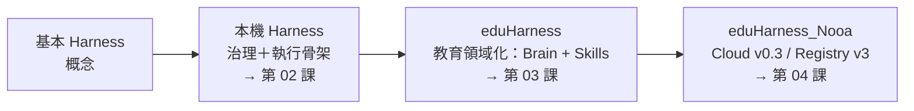

# 01｜什麼是 Harness？（模型外圍的執行／治理層）

> **一句話**：LLM 負責理解、生成、提出候選行動；**Harness 是模型外圍的執行、控制與證據層**——決定模型看到什麼、能用哪些工具、哪些動作允許執行、狀態怎麼保存、結果怎麼驗證。
>
> 來源：[Harness → eduHarness → eduHarness_Nooa 架構視覺化](https://bai-collab.github.io/eduHarness_Nooa/docs/harness-eduharness-nooa-architecture.html)（本地：[`references/eduHarness_Nooa/harness-eduharness-nooa-architecture.html`](../references/eduHarness_Nooa/harness-eduharness-nooa-architecture.html)）「基本 Harness」段落。

---

## 1. 概念圖

> ⚠️ 原文標註：此圖由 AI 根據通用 Agent Harness 文件整理，不是任何單一產品的官方 Figure。

## 2. 六個元件怎麼講

| 元件 | 用課堂語言說 | 對照 Claude Code 的例子 |
|---|---|---|
| Context / Memory | 模型「這次看得到什麼」 | CLAUDE.md、對話摘要、mod 注入的 `context`（見 [05](05-claude-code-mod-hook-flow.md)） |
| Plan / Act / Observe | 想→做→看結果→再想的迴圈 | Agent 呼叫工具後讀輸出再決定下一步 |
| Tools / Routing | 能用哪些工具、交給誰做 | Bash、Edit、subagent、MCP |
| Permissions / Guardrails | 什麼不能做、什麼要先問 | 權限模式、hook 攔截 |
| State / Recovery | 中斷後能從哪裡接 | checkpoint、計畫書狀態 |
| Verification / Observability | 怎麼證明做對了 | 測試、log、獨立審查 |

## 3. 兩個容易混淆的層次

| | 基本／通用 Harness | 本機 Harness |
|---|---|---|
| 性質 | 概念層 | 具體實作（`eduHarness-/harness/`） |
| 內容 | context、tools、權限、state、迴圈、驗證 | Kernel、Registry、Route Plan、Skill resolution、preflight、user authority、verify / replan |

> **重要**（原文）：「基本 Harness → 本機 Harness」是**概念到實作的對照**，不表示 repository fork 或版本血統。

## 4. 演進主線（之後幾課的路線圖）

## 5. 原文引用的外部來源

- Cloudflare Agents Docs — Harnesses
- Australian Cyber Security Centre — Agentic AI harnesses

## 6. 課堂提問

1. 同一個模型，換一個 Harness，表現為什麼可能差很多？
2. 「模型自己會判斷要不要刪檔案」——這句話錯在哪一層？（答：權限與防護應該由 Harness 決定，不是模型）
