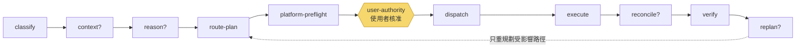
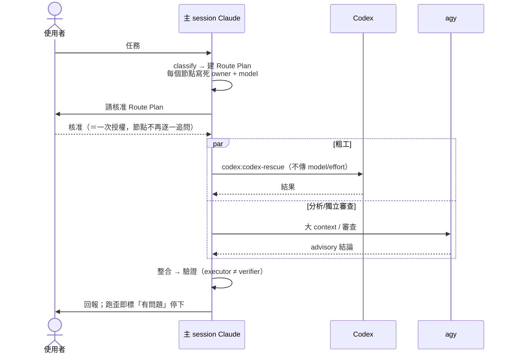

# 02｜本機 Harness：治理全景圖、Adaptive Loop 與多執行者分工

> 🧭 **單元三・第 2 步**｜上一步：[動畫：本工作區的 Harness](https://bai-collab.github.io/llm_teach/animations/harness-tour/)｜下一步：[03 eduHarness Skill](03-eduharness-skills-workflow.md)｜[課程地圖](../README.md)｜[網站版](https://bai-collab.github.io/llm_teach/)

> **一句話**：一套只跑在本機的**可插拔治理骨架**——把「治理規則」和「執行環境」拆開；非瑣碎任務先畫 **Route Plan**，經**使用者核准**才動工；主 session Claude 思考裁決、Codex 做粗工、agy 做獨立審查。
>
> 來源：
> - [治理 Harness 全景圖（harness-map.html）](https://bai-collab.github.io/eduHarness_Nooa/docs/harness-map.html)（本地：[`references/eduHarness_Nooa/harness-map.html`](../references/eduHarness_Nooa/harness-map.html)）
> - [bai-collab/eduHarness-](https://github.com/bai-collab/eduHarness-)：`AGENTS.md`、`harness/docs/architecture.md`、`harness/blocks/*.mjs`

---

## 1. 一句話原則：規則與執行分離

| Governance · 治理規則（規則怎麼寫） | Environment · 執行環境（實際在哪跑） |
|---|---|
| 生命週期、使用者權限、Route Plan 契約、驗證策略 | 主 Agent、rule-tool、Codex、Claude、Antigravity 等本機 adapter |
| 全用 repository 相對路徑，可攜、可稽核 | 缺了某個平台不會卡死整條流程，自動 fallback |

♚ **使用者裁決是最高權限**。模型只能提「建議（advisory）」，永遠不能覆蓋使用者決定。**核准 Route Plan＝授權開工。**

## 2. 任務怎麼流動（Adaptive Loop）

- `?` ＝ optional 區塊，簡單任務可略過；金色＝必經的使用者授權閘門。
- 對映程式：11 個 `harness/blocks/*.mjs`，由 `harness/cli/harness.mjs` 驅動。
- 必要區塊：classify / route-plan / preflight / authority / dispatch / execute / verify。

| 階段 | 區塊 | 講解重點 |
|---|---|---|
| 前段：理解與規劃 | classify → context → reason → route-plan | 先判斷複雜度，再決定要不要補脈絡、要不要推理鷹架 |
| 中段：權限與執行 | preflight → user-authority → dispatch → execute | 平台先無副作用探測；使用者核准後才派工 |
| 後段：整合與修正 | reconcile → verify → replan | 驗證失敗只重做受影響的節點 |

## 3. Route Plan 契約：每個節點都要答得出

（出自 `eduHarness-/harness/docs/architecture.md`）

1. 要完成什麼 **objective**？
2. 依賴哪些前置節點（`depends_on`）？
3. 原本指定哪個 **platform／agent／role**？
4. 平台不可用時由誰接手（**fallback**）？
5. 需要 node、final、escalate 還是 none **verifier**？
6. 實際使用的平台與結果**證據**是什麼？

> **Skill 是旁路**：Skill 解析不得新增、刪除、重排 Route Plan 節點，也不得改變 verifier 預算。

## 4. 六層架構 × 對應資料夾

| 層 | 負責 | 住在哪 |
|---|---|---|
| 治理層 Governance | 規則 SSOT、模型分工路由、生命週期、使用者權限 | `AGENTS.md` `CLAUDE.md` `README.md` `harness/config/` `harness/docs/` |
| 規劃層 Planning | 建 Route Plan、非主平台無副作用 preflight | `blocks/route-plan.mjs` `platform-preflight.mjs` `core/planner.mjs` `config/route-profiles.json` `config/platform-registry.json` |
| 執行層 Execution | dispatch 依 Route Plan 交給 adapter；缺 adapter → fallback 或 deferred | `blocks/dispatch.mjs` `execute.mjs` `runtime/adapters/` |
| 驗證層 Verification | 依風險節流；獨立性 disabled / preferred / required | `blocks/verify.mjs` |
| 知識層 Brain | 動工前先檢索（CONSULT-before-act），踩雷即回寫 | `brain/skills/` `brain/knowledge/` `brain/error-log/` `brain/experience/` `brain/index.json` |
| 產物層 Artifacts | 之後還會改→`projects/`；本次交付→`outputs/`；暫存→`workspace/` | `planned/` `projects/` `outputs/` `workspace/` `references/` |

## 5. 三個執行者，各司其職

> 原文模型版本：主 session Claude「Opus 4.8 · high」、Codex「gpt-5.6-luna · CLI 預設 max」、agy「Antigravity / Gemini CLI」——以原文為準，可能隨時間更新。

| 角色 | 比喻 | 做什麼 | 注意 |
|---|---|---|---|
| 主 session Claude | 腦 | 計畫書、架構設計、執行 Skill、審查整合、最終判斷 | 框架、架構、模糊、整合**永遠留在主 session** |
| Codex | 手 | 找資料、寫程式、搬移、完整規格的重複實作 | 走 `codex:codex-rescue`；**不覆寫 model / effort**；無自動記憶 → 更要 CONSULT-before-act |
| agy | 眼 | 大 context 通讀、**第三個模型家族**的獨立審查 | 本機目前僅 advisory |

### 主 session 怎麼派工

三條安全規則：
- 🔐 **安全敏感節點**（authn/authz、secrets、加密、輸入驗證、漏洞分析）**永不進 Codex**；審查交給與執行者不同的模型。
- ✋ 碰到**範圍變動或不可逆／外部變更**（push、發布、刪除）一律停下問使用者。
- 🧭 **fallback 不擴權**：平台不可用由主 Agent 接手並記錄 requested / actual 差異，不得擴大 allowed paths。

## 6. 驗證要派多重？（Verifier budget）

| Profile | 預設驗證 | 獨立性 | 節點 verifier 上限 | 說明 |
|---|---|---|---|---|
| Simple | none | disabled | 0 | 只做輕量 plan contract 檢查 |
| Standard | final | preferred | 0 | 任務最後統一驗證一次；不可用可降級但須留 gap |
| Complex | node-or-final | required | 1 | 高風險／跨平台節點才派；required 需可辨識的不同身分 |

> **The Invariant · 不變式：「誰做的，不由自己審。」**

## 7. 計畫書拓樸圖規則（AGENTS.md 全域設定，可當課堂作業規範）

> 先看動畫：[為什麼要先寫計畫書？](https://bai-collab.github.io/llm_teach/animations/why-plan-first/)（130 秒）——注意力是有限預算、長任務為什麼會走偏，以及計畫書怎麼把目的與階段留在上下文窗口外面。

每份計畫書要有 Mermaid 執行拓樸圖，每個節點寫：**節點 ID／功能／使用 agent／狀態（已執行・未執行・有問題）**；每完成一節點立即回寫並做 drift review；中斷後從第一個非「已執行」節點續接；不保存私有 chain-of-thought。

## 8. 課堂提問

1. 為什麼「核准整張 Route Plan」比「每個節點都問」好？風險在哪？
2. 為什麼要刻意用**不同模型家族**做審查？
3. fallback 時若自動擴大 allowed paths，會出什麼事？
