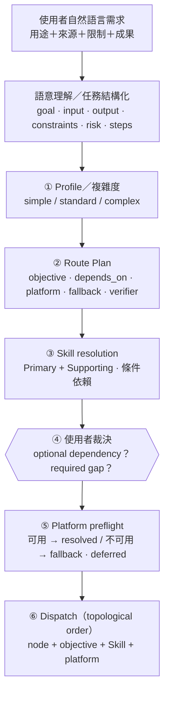
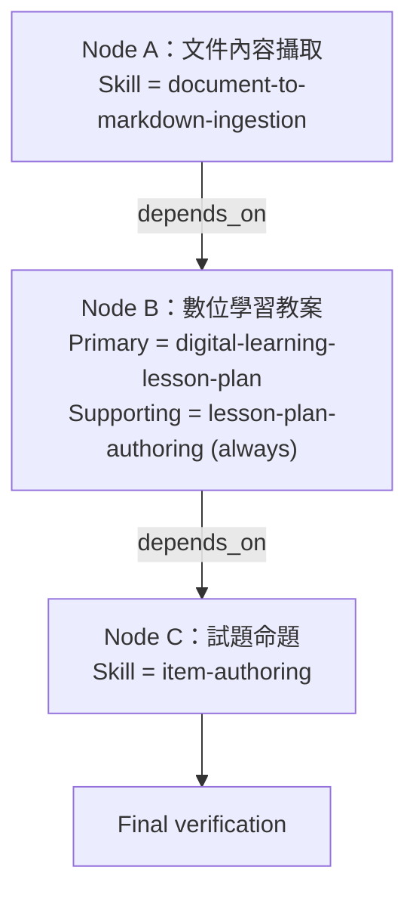

# 03｜eduHarness：Skill 套件與「用途 → 工作流程」

> 🧭 **單元三・第 3 步**｜上一步：[02 本機 Harness](02-local-harness-adaptive-loop.md)｜下一步：[04 eduHarness_Nooa](04-eduharness-nooa-cloud-registry-v3.md)｜[課程地圖](../README.md)｜[網站版](https://bai-collab.github.io/llm_teach/)

> **一句話**：eduHarness 在本機 Harness 上加入 **Brain／Knowledge／Templates** 與教育 **Skill packages**，把 Harness 變成教師工作台；Skill **按需載入**，而且**不會偷改 Route Plan**。
>
> 來源：
> - [架構視覺化](https://bai-collab.github.io/eduHarness_Nooa/docs/harness-eduharness-nooa-architecture.html)「eduHarness」「Skill 與工作流程」段落
> - [bai-collab/eduHarness-](https://github.com/bai-collab/eduHarness-)：`README.md`、`harness/config/skill-registry.json`、`harness/docs/skills.md`、`brain/skills/`
> - 架構地圖站：[bai-collab/eduHarness-docs](https://github.com/bai-collab/eduHarness-docs)（`index.html`：eduHarness 架構地圖＋Pixel Art 闖關遊戲範例）

---

## 1. Skill 是什麼？Brain 是什麼？

| 名詞 | 定義 |
|---|---|
| **Skill** | 針對特定工作整理好的能力模組：使用時機、輸出規則、相依 Skill、工具、驗證方式。**不只是 prompt**，是可註冊、可驗證、可按需載入的套件 |
| **Brain** | 知識、Skill、範本**先索引、後按需載入**；不因建立任務就把全部資料塞進 context |
| **Registry** | 記錄 ID、繁中名稱、kind、trigger／anti-trigger、dependencies、capabilities、preferred platforms、verifier policy、required files、package hash（SHA-256 tree hash） |

## 2. 17 個內建 Skill（README 版）

> ⚠️ 版本差異：README／架構視覺化寫 **17 個**；harness-map 頁尾寫「40 skills 登錄」、知識層段落寫「27 個」。講課時說明「數量隨版本成長，以 `skill-registry.json` 為準」。

| 類別 | Skill（id） |
|---|---|
| 教學、命題與推理（7） | 教案撰寫 `lesson-plan-authoring`、數位學習精進教案 `digital-learning-lesson-plan`、教案差異化 `lesson-differentiation`、試題命題 `item-authoring`、臆測五階段 `conjecturing-five-stage`、AI 文件 Markdown 轉換 `document-to-markdown-ingestion`、證據式推理核心 `reasoning-kernel` |
| 遊戲、Web 與 3D（6） | 教材轉闖關遊戲、教育 Web 教學遊戲工作流、闖關遊戲 Three.js 導入、圖片轉 3D 場景、網頁版面拓樸分析、程序化場景共用世界與量測迭代 |
| 視覺、寫作與輸出（4） | 美工與分鏡設計、Pixel AI 美術提示詞祕書、海明威寫作法、行動優先輸出 |

## 3. 使用者用途 → Skill workflow

> ⚠️ 實作邊界（原文）：Registry 有 triggers / anti-triggers，但 `classify.mjs` 主要記錄 profile signals；**不能**宣稱 runtime 已完整實作「自然語言 → trigger → 自動挑 Skill」。

## 4. Skill dependency 的 6 種條件

| 條件 | 何時載入 |
|---|---|
| `always` | 選到父 Skill 就載入 |
| `content-input` | 有文件／內容來源時 |
| `reasoning-needed` | 需要較完整推理時 |
| `verifier-required` | Route Plan 安排 verifier 時 |
| `high-risk` | task risk 為 high / critical |
| `user-confirmed` | 必須停在 user-authority，由使用者決定「載入／先略過」 |

## 5. 範例：PDF 教材 → 數位教案 → 題庫

> **講解重點**：A → B → C 是 **Route Plan 的工作依賴**；「數位學習精進教案 → 教案撰寫」是 **Skill dependency**。兩者不是同一件事。

## 6. 為什麼這樣設計？（README）

- **按需載入，減少干擾**：簡單任務只載入必要能力。
- Skill 不會預載，也不會改寫 Route Plan；只產生獨立的 `skill_resolution` artifact。
- 新建 Skill 必須先登錄 `skill-registry.json`，且要有繁體中文可見名稱（`harness:validate` 會檢查）。

## 7. 相關 Skill 套件範例（可現場展示）

- [bai-collab/teacher_UI](https://github.com/bai-collab/teacher_UI)：`teacher-workspace-ui` Skill——一個完整的 Skill package 長什麼樣（`SKILL.md`、`references/`、`assets/template/`、`agents/openai.yaml`、`VERSION`）。詳見 [06](06-related-llm-projects.md)。

## 8. 課堂提問

1. Skill 和「一段很長的 system prompt」差在哪？（提示：註冊、依賴、驗證、按需載入、hash）
2. 為什麼 Skill 不能改 Route Plan？如果可以會發生什麼事？
