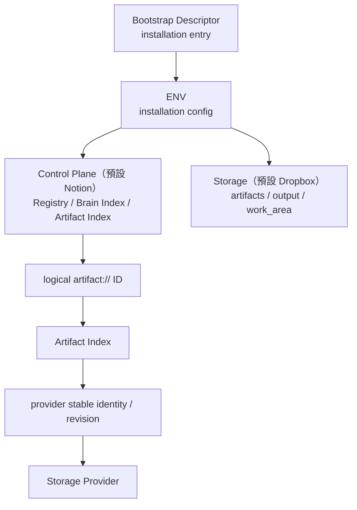
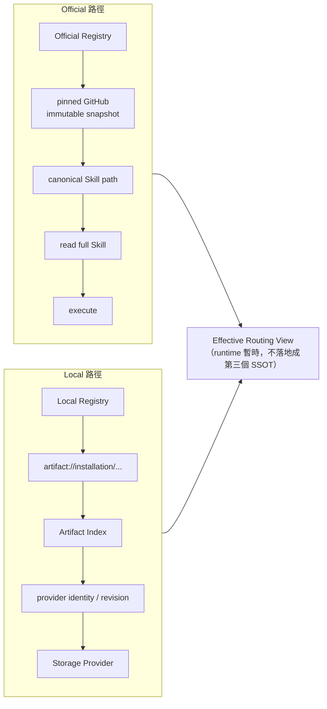

# 04｜eduHarness_Nooa：Cloud 版與 Registry v3 雙層治理

> **一句話**：把 eduHarness 搬上 ChatGPT Web / Gemini Spark——安裝、控制平面、儲存與 canonical distribution 解耦；Registry v3 分成 **Official（GitHub 唯讀快照）＋ Local（安裝者自有 overlay）**。
>
> 來源：
> - [架構視覺化](https://bai-collab.github.io/eduHarness_Nooa/docs/harness-eduharness-nooa-architecture.html)「eduHarness_Nooa」「差異比較」「證據來源」段落
> - [bai-collab/eduHarness_Nooa](https://github.com/bai-collab/eduHarness_Nooa)（commit `dfd42ae`）：`README.md`、`docs/REGISTRY_V3_DUAL_LAYER_CONTRACT.md`、`docs/EDUHARNESS_CLOUD_V0_2_MASTER_PLAN.md`、`docs/INSTALL_UPGRADE.md`
> - 流程圖：[`references/eduHarness_Nooa/eduHarness_Nooa-flow.png`](../references/eduHarness_Nooa/eduHarness_Nooa-flow.png)

---

## 1. 版本定位

| 項目 | 值 |
|---|---|
| Active Distribution | `2026.08.13-registry-v3` |
| Architecture | v0.3 · channel `stable` |
| 設計原則 | **Descriptor-first、Provider-separated** |
| 目標平台 | ChatGPT Web、Gemini Spark |

> ⚠️ 原文提醒：README 仍有 v0.2 / Registry v2 描述（Distribution `2026.08.12`）；較新的 Distribution manifest、Project Instructions 與 Official Registry 已推進到 v0.3 / Registry v3。

## 2. 核心解析架構（README）



目的：讓 capability / knowledge 的身分**不再綁死某個 Drive 路徑或 provider**。Google Drive 降為 optional / legacy。

## 3. 運行流程與 Human Gate

**理解任務 → 決定 Skill → 規劃 → 執行 → 驗證 → 迭代優化 → 完成交付／經驗累積**

- 驗證失敗觸發 re-plan，只重做受影響路徑。
- 需要 **Human Gate**：學生個資、正式評量、正式送件／公開、付費服務、刪除資料、批次搬移／覆寫、重大 Registry／治理修改、Canonical Distribution promotion。
- Runtime State 預設 ephemeral；private chain-of-thought 不持久化。

## 4. Registry v3：雙層路由



**權限優先順序**：

```text
Project governance（Kernel）
  > Local explicit policy
  > Official Registry
  > Skill self-routing
```

| | Official Registry | Local Registry |
|---|---|---|
| 來源 | GitHub Canonical Distribution | 安裝者自有 overlay |
| 可變性 | read_only | 安裝者可寫 |
| namespace | `edu` | `local` |
| 限制 | — | 不可覆寫 governance、Human Gate、隱私、安全、失敗與 runtime 不變式 |

**Snapshot 規則**（講解亮點）：一次 routing/execution 週期中，Official Registry 與所有 Official Skill/Knowledge **必須來自同一個 commit SHA**；上游中途更新**不得**改變執行中的快照。解析不到 → `SOURCE_UNAVAILABLE` / `RUNTIME_INCOMPATIBLE` 停止（fail-closed）。

## 5. Registry v2 的 6 種 typed relations（仍是基礎）

| relation | 意義 |
|---|---|
| `requires` | 必要前置 |
| `enhances` | 條件式輔助能力 |
| `routes` | Primary Skill 責任轉移 |
| `conflicts` | 阻擋／解決不相容的啟用 |
| `replaces` | 轉向／遷移 |
| `supports` | 僅資訊性 |

> 不能把六種 relation 當成同一種 graph edge。

## 6. 四代差異比較（原文表格）

| 面向 | 基本 Harness | 本機 Harness | eduHarness | eduHarness_Nooa |
|---|---|---|---|---|
| 定位 | 通用 Agent 概念 | 本機治理／執行引擎 | 教育領域工作台 | Cloud Canonical Distribution |
| 核心 | Context / tools / state / control / verify | Blocks + Route Plan + preflight + authority | Brain + 17 Skills | Official + Local Registry |
| 路由 | 概念性 | Route nodes / dependencies | Route Plan + Skill resolution | Effective Routing View |
| 技能 | 不一定有固定 Skill 模型 | Registry 可解析 Skill | 教育專用 Skill packages | Official + Local Skills |
| 儲存 | 依系統而定 | 本機 repository-relative | Brain / workspace | Descriptor → ENV → providers |
| 安全治理 | Permissions / guardrails | User authority + verifier budget | 教育流程人工審查 | Human Gate + fail-closed + snapshot |

## 7. 證據與判讀強度（原文）

| 結論 | 狀態 |
|---|---|
| 通用 Agent Harness 是模型外圍執行／治理層 | ✅ 外部文件一致 |
| 本機 Harness 有 adaptive loop、Route Plan、Skill resolution、preflight、authority、verify / replan | ✅ 原始碼／架構文件 |
| eduHarness- 以 Brain + 17 Skills 擴充 Harness | ✅ README / Registry |
| Route Plan 與 Skill resolution 分離 | ✅ architecture.md / route-plan.mjs |
| classify 不足以證明自然語言已直接用 Registry trigger 自動選 Skill | ⚠️ 實作邊界 |
| Nooa current canonical architecture 為 v0.3 / Registry v3 / stable | ✅ Distribution manifest |
| README v0.2 描述落後於 v0.3 manifest | ❗ 版本差異 |

## 8. 可攜性／隱私（README）

Canonical Distribution **不得**包含：安裝者專屬的 Notion / Dropbox / Drive ID、他人的 ENV、私有 Brain、教師產出、學生個資、secrets / tokens。

## 9. 延伸閱讀（repo 內 `docs/`）

| 主題 | 檔案 |
|---|---|
| 安裝／升級 | `docs/INSTALL_UPGRADE.md`、`docs/CHATGPT_PAID_INSTALL_GUIDE.md` |
| 契約 | `BOOTSTRAP_DESCRIPTOR_CONTRACT.md`、`CONTROL_PLANE_CONTRACT.md`、`STORAGE_ADAPTER_CONTRACT.md`、`RUNTIME_STATE_CONTRACT.md`、`LOCAL_REGISTRY_CONTRACT.md` |
| Registry 演進 | `REGISTRY_V1_GRAPH_AUDIT.md` → `REGISTRY_GRAPH_SCHEMA_V2.md` → `REGISTRY_V3_V2_TO_V3_MIGRATION_PLAN.md` → `REGISTRY_V3_DUAL_LAYER_CONTRACT.md` |
| 總計畫 | `EDUHARNESS_CLOUD_V0_2_MASTER_PLAN.md` |
| Resolver 程式 | `tools/registry-v3-resolver/resolver.mjs`（含 `test.mjs`） |

## 10. 課堂提問

1. 為什麼 Effective Routing View 不能存成第三份 Registry？
2. 為什麼執行中途要鎖住同一個 commit SHA？舉一個不鎖會出錯的情境。
