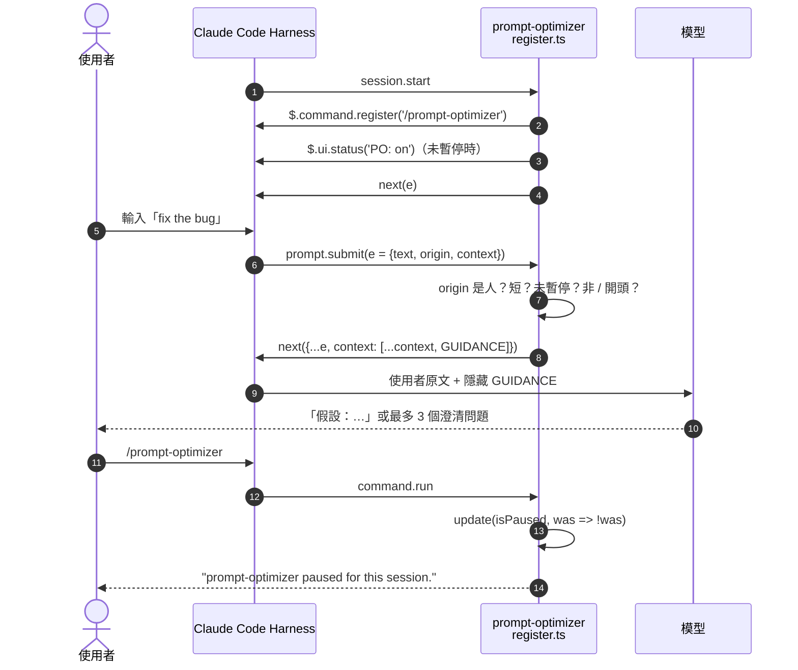
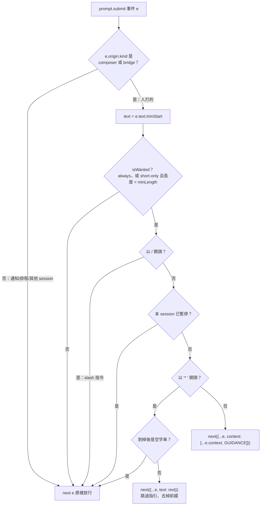

# 05｜Claude Code Mod：Hook 流程拆解（prompt-optimizer）

> **一句話**：mod（plugin）用 function hooks 在 Claude Code 的事件管線上「插一段中介層」——收到事件 `e`，決定要不要改它，再交給 `next(e)` 往下傳。
>
> 來源：[bai-collab/claude_code_mod](https://github.com/bai-collab/claude_code_mod)（commit `e1ee8a0`）｜本地快照：[`references/claude_code_mod/`](../references/claude_code_mod/)
> ⚠️ README 註明 function hooks（`hooks/register.ts`）是 **early access API**，介面可能變動。

---

## 1. 這個 mod 做什麼？

`prompt-optimizer`：使用者輸入**太短或含糊**的 prompt 時，偷偷附上一段「先釐清、再動手」的指引給模型：

- 缺少只有使用者能決定的事 → 最多問 **3 個**澄清問題。
- 否則直接做，並在回覆第一行寫出**自己做了哪些假設**。

關鍵：指引放進 `context`（模型看得到、使用者看不到），**不改寫使用者原文**。

| 使用方式 | 效果 |
|---|---|
| 正常輸入 | `short-only` 模式下，< 80 字元的 prompt 會被附上指引 |
| 開頭打 `* `（星號＋空白） | 這一句跳過指引；只有在「本來會套用指引」時才剝掉 `* ` |
| `/prompt-optimizer` | 本 session 暫停／恢復 |
| `/config` | 改 `mode`（`short-only` / `always` / `off`）與 `minLength` |
| 狀態列 | 啟用中顯示 `PO: on` |

---

## 2. 檔案結構（講解時先看這張）

```text
claude_code_mod/
├─ .claude-plugin/marketplace.json      # marketplace 清單：列出可安裝的 plugin
└─ plugins/prompt-optimizer/
   ├─ .claude-plugin/plugin.json        # plugin 名稱、版本、userConfig（mode / minLength）
   ├─ hooks/hooks.json                  # { "modules": ["./register.ts"] } → 告訴 harness 載入哪個模組
   ├─ hooks/register.ts                 # ★ 主邏輯：註冊 3 個事件處理器
   ├─ hooks/register.test.ts            # 用 claude-code/testing 寫的單元測試
   └─ types/index.d.ts                  # 宣告 plugin 狀態型別（isPaused: boolean）
```

**載入鏈**：`plugin.json`（設定）→ `hooks.json`（模組清單）→ `register.ts` 匯出 `register(on, options)` → harness 呼叫它，`options` 就是 `userConfig` 的值。

---

## 3. 三個 hook 一覽

| 事件 | 何時觸發 | 這個 mod 做什麼 |
|---|---|---|
| `session.start` | session 開始（`/config` 修改後模組重載也會再觸發） | 註冊 `/prompt-optimizer` 指令；讀 `isPaused`，設定狀態列 `PO: on` |
| `command.run`（`{ command: 'prompt-optimizer' }`） | 使用者執行 `/prompt-optimizer` | 翻轉 `isPaused`，更新狀態列，回傳提示文字 |
| `prompt.submit` | 使用者送出 prompt 時 | 判斷要不要附加 `GUIDANCE` 到 `e.context` |



---

## 4. `prompt.submit` 決策流程（本課重點）



### 逐段講解（對照 `register.ts`）

```ts
const HUMAN_ORIGINS = new Set(['composer', 'bridge'])
```
- **只處理「人打的字」**：`composer`＝終端機輸入框，`bridge`＝Remote Control。背景通知、排程任務、其他 session 傳來的訊息一律不碰 → 避免 mod 汙染自動化流程。

```ts
const isWanted = mode === 'always' || (mode === 'short-only' && text.length < minLength)
if (!isWanted || text.startsWith('/') || (await read($, isPaused))) return next(e)
```
- **三道放行條件**：不需要、是 slash 指令、已暫停 → 原封不動 `next(e)`。

```ts
if (text.startsWith(BYPASS)) {
  const rest = text.slice(BYPASS.length).trimStart()
  return rest === '' ? next(e) : next({ ...e, text: rest })
}
```
- **逃生口 `* `**：注意它放在「確定要套用指引」**之後**才檢查。所以：
  - 長 prompt 開頭是 markdown 清單 `* item…` → 不會被誤剝（測試 `a long prompt keeps its leading "* "`）。
  - `off` 模式 → 不剝（測試 `off mode keeps the leading "* "`）。
  - 只有 `* ` → 不會被剝成空 prompt（測試 `a bare "* " is sent as typed`）。

```ts
return next({ ...e, context: [...(e.context ?? []), GUIDANCE] })
```
- **不可變更新 + 疊加**：複製 `e`、在既有 `context` 後面「加」一段，不覆蓋其他 mod 已放的 context → 多個 mod 可以串接。

---

## 5. 三個值得講的設計觀念

1. **中介層（middleware）模式**：每個 handler 拿到 `($, e, next)`。呼叫 `next(e')` ＝把（可能改過的）事件交給下一層；不呼叫就是攔截。和 Express／Koa middleware 同一個思路。
2. **狀態用 atom，不用全域變數**：
   ```ts
   const isPaused = atom({ plugin: 'prompt-optimizer', key: 'isPaused' } as const, false)
   ```
   `/config` 會讓模組重新載入；模組內的 `let` 變數會被清掉，但 atom 存在 harness 裡，**暫停狀態能撐過重載**（原始碼註解特別提到）。型別由 `types/index.d.ts` 的 `PluginState` 擴充宣告。
3. **context 注入 vs 改寫 prompt**：改寫使用者文字會讓人看到的≠模型看到的，難除錯；注入隱藏 context 保留原文，可透明說明（README 也明說「your prompt text is not rewritten」）。

---

## 6. 測試怎麼寫（`register.test.ts`）

測試用 `claude-code/testing` 的 `describe / test / expect`。手法：**在 mod 之後再掛一個 `prompt.submit` 監聽器，偷看最後傳到下游的 `e`**。

```ts
test('attaches guidance to a short prompt', async ($, on) => {
  let seen
  on('prompt.submit', (_, e) => { seen = e.context; return { text: e.text } })
  await $.prompt.submit({ text: 'fix the bug', wait: false, origin: { kind: 'composer' } })
  expect(seen).toEqual([GUIDANCE])
})
```

| 測試名稱 | 驗證的行為 |
|---|---|
| attaches guidance to a short prompt | 短 prompt → 附加指引 |
| leaves a long prompt alone | 200 字 → 不附加 |
| the bypass prefix strips itself and skips guidance | `* fix the bug` → 文字變 `fix the bug`、無指引 |
| ignores prompts not typed by the person | `task-notification` 來源 → 不處理 |
| always mode guides long prompts too | `{ options: { mode: 'always' } }` 覆寫設定 |
| the command pauses guidance | 執行指令後 → 不再附加 |
| a bare "* " is sent as typed, never emptied | 邊界：不送出空 prompt |
| a long prompt keeps its leading "* " | 邊界：不誤剝 markdown 清單 |
| off mode keeps the leading "* " | 邊界：off 模式完全不碰 |

開發指令：
```bash
claude plugin validate plugins/prompt-optimizer
claude plugin test plugins/prompt-optimizer
```

---

## 7. 安裝

```bash
git clone https://github.com/bai-collab/claude_code_mod
claude --plugin-dir ./claude_code_mod/plugins/prompt-optimizer
```

Marketplace 路線（README 標註：function-hook plugin 尚未驗證）：
```text
/plugin marketplace add bai-collab/claude_code_mod
/plugin install prompt-optimizer@claude-code-mod
```

---

## 8. 課堂討論／練習

1. **觀念題**：為什麼 `* ` 的檢查要放在 `isWanted` 判斷之後？若放最前面會壞掉哪個測試？（答：`a long prompt keeps its leading "* "`、`off mode keeps…`）
2. **觀念題**：若把 `context: [...(e.context ?? []), GUIDANCE]` 改成 `context: [GUIDANCE]`，跟其他 mod 一起用時會發生什麼事？
3. **動手**：新增 `mode: 'keywords'`，只在 prompt 含「幫我」「弄一下」等模糊詞時附加指引；同步改 `plugin.json` 的 `options` 並補兩個測試。
4. **延伸**：對照 [02 本機 Harness](02-local-harness-adaptive-loop.md) 的「使用者權限最高」原則——這個 mod 只「建議模型先問」，不替使用者做決定，屬於哪一層的治理？

## 9. 常見誤解

| 誤解 | 正確理解 |
|---|---|
| mod 會改寫我的 prompt | 不會；只加隱藏 `context`。唯一例外是剝掉 `* ` 前綴 |
| 所有訊息都會被加指引 | 只有 `composer` / `bridge`（人打的）會 |
| `/config` 改設定後暫停狀態會重置 | 不會；`isPaused` 存在 atom，撐過模組重載 |
| function hooks 是穩定 API | README 標示為 early access |
